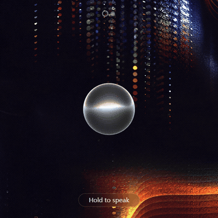
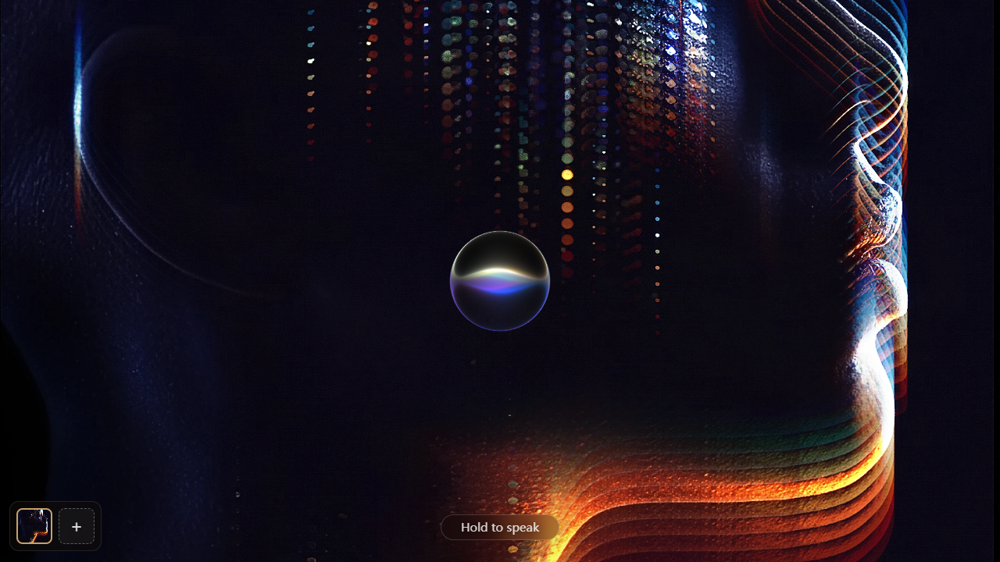
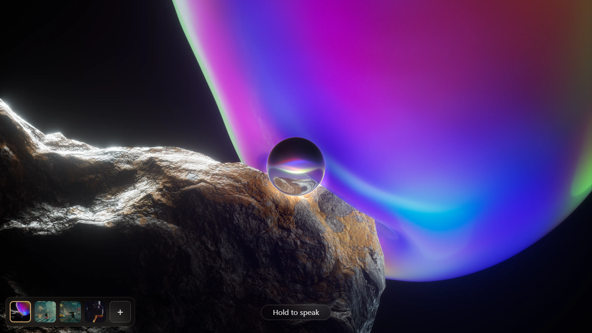
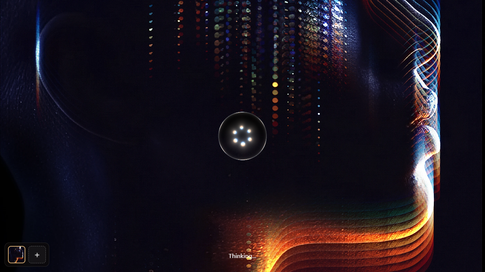
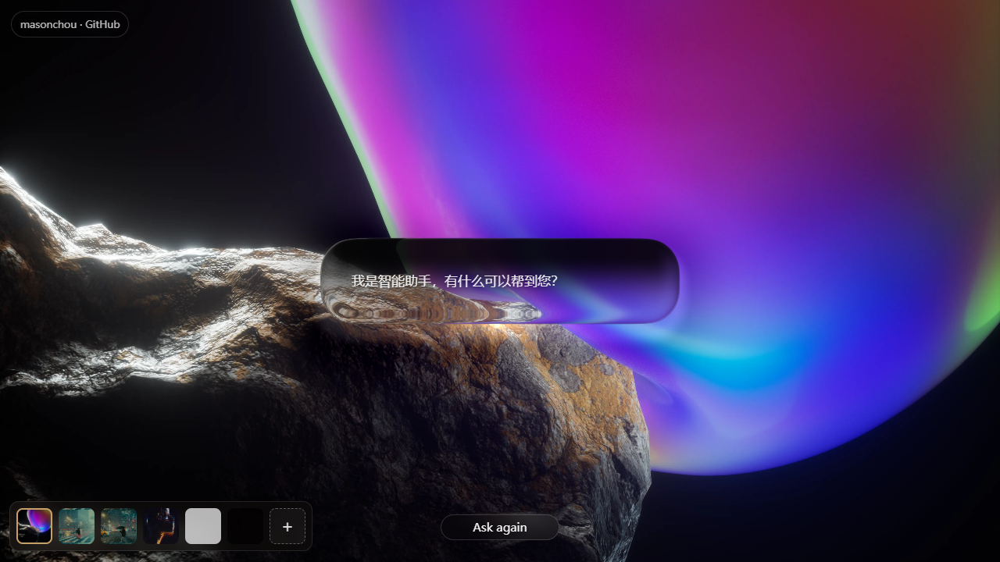
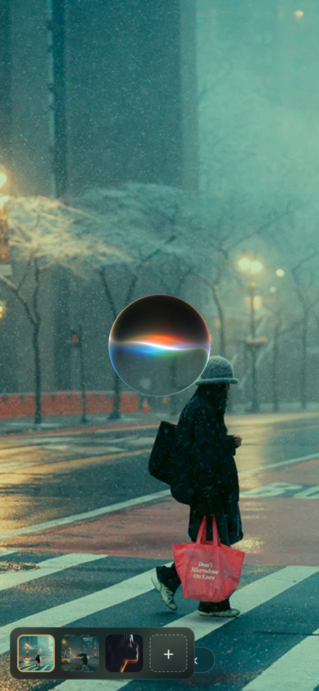

# Glass Voice Orb Study / 玻璃语音球学习项目

Non-commercial WebGL study of a liquid-glass voice orb interaction.
Estudio WebGL no comercial de la interacción con un orbe de voz de vidrio líquido.

Este es un proyecto de aprendizaje no oficial. No está afiliado, respaldado ni patrocinado por Apple ni por ningún equipo de productos. El proyecto se proporciona únicamente para estudio personal y experimentación no comercial solo.
这是一个非官方学习项目，与 Apple 或任何产品团队无关联、无认可、无赞助。本项目仅用于个人学习和非商业实验。

## Demo / 本地演示

Online demo:
Demostración en línea:

```text
https://zq52xy.github.io/glass-voice-orb-study/
```

Run a local static server from the repository root:
Ejecutar un servidor estático local desde la raíz del repositorio:

```bash
python -m http.server 4173 --bind 127.0.0.1
```

Open:
Abrir:

```text
http://127.0.0.1:4173/
```

## Preview / 预览

The preview assets below are captured from the current GitHub Pages build with the tuning panel hidden.
Los activos de vista previa a continuación se capturan de la compilación actual de GitHub Pages con el panel de ajuste oculto.

Interaction demo:
Demostración de interacción:



Desktop states and reply container:
Estados de escritorio y contenedor de respuesta:

| Idle / 待机 | Listening / 聆听 |
| --- | --- |
|  |  |

| Thinking / 思考 | Reply / 回复 |
| --- | --- |
|  |  |

Mobile:
Móvil:



## Features / 功能

- WebGL2 multi-pass glass rendering.
- Renderizado multi-paso WebGL2 de vidrio.
- Voice-orb idle, listening, and thinking states.
- Estados de inactividad, escucha y pensamiento del orbe de voz.
- Morphing glass reply container with centered assistant copy.
- Contenedor de respuesta de vidrio con transformación y texto del asistente centrado.
- Optional microphone-reactive animation with demo fallback.
- Animación opcional reactiva al micrófono con respaldo de demostración.
- Included personal and solid-color background presets for the demo.
- Incluidos preset de fondo personales y de color sólido para la demostración.
- In-browser tuning panel. Press `H` to hide or show it.
- Panel de ajuste en navegador. Presione `H` para ocultar o mostrarlo.
- Tunable exterior shadow, caustic projection, vertical offsets, and light/shadow boundary softness.
- Sombra exterior ajustable, proyección caustica, desplazamientos verticales y suavidad del límite de luz/sombra.

## License / 许可

This repository is source-available for study and non-commercial use only. See [LICENSE](./LICENSE) and [NOTICE.md](./NOTICE.md).
Este repositorio es de acceso fuente para estudio y uso no comercial únicamente. Consulte [LICENSE](./LICENSE) y [NOTICE.md](./NOTICE.md).

Shader/source attribution is maintained in [NOTICE.md](./NOTICE.md), including the Shadertoy reference used as part of the study provenance.
La atribución de sombreadores/fuentes se mantiene en [NOTICE.md](./NOTICE.md), incluyendo la referencia de Shadertoy utilizada como parte de la procedencia del estudio.

The included personal background images are personal demo assets and are not licensed for reuse outside this repository. Solid-color presets are generated demo assets and follow the repository license.
Las imágenes de fondo personales incluidas son activos de demostración personales y no están licenciados para su reutilización fuera de este repositorio. Los preset de color sólido son activos de demostración generados y siguen la licencia del repositorio.

## Notes / 注意事项

- Do not use this project or its assets commercially.
- No utilice este proyecto ni sus activos comercialmente.
- Do not imply affiliation with Apple or Siri.
- No impute afiliación con Apple o Siri.
- If you replace the background image, use your own authorized asset.
- Si reemplaza la imagen de fondo, use su propio activo autorizado.
